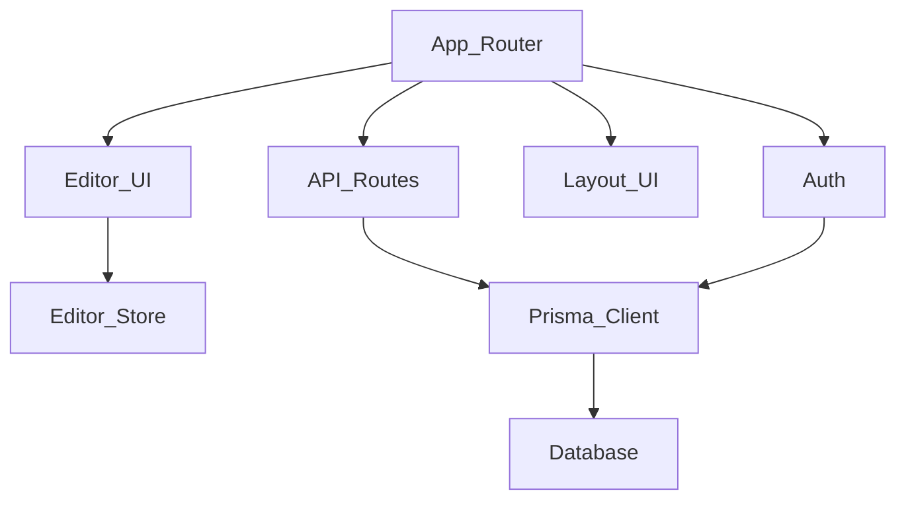

## Stack
- TypeScript, Next.js 16 (App Router) — package.json "next": "^16.2.0"
- React 19, Zustand (state) — package.json dependencies
- Tiptap 3 / ProseMirror rich-text editor — package.json @tiptap/* deps
- Prisma ORM (prisma/schema.prisma) + Auth.js/NextAuth v4, Tailwind CSS v4

## Directory map
| path | what lives there |
|---|---|
| `src/app` | Next.js App Router root: `layout.tsx`, `page.tsx`, `globals.css`, `middleware.ts` |
| `src/app/(auth)` | `layout.tsx`, `login/` — auth route group |
| `src/app/(app)` | `layout.tsx`, `dashboard/`, `documents/`, `trash/` — authenticated route group |
| `src/app/api` | `auth/`, `documents/` — REST API route handlers |
| `src/components/editor` | `Editor.tsx`, `EditorToolbar.tsx`, `extensions/` — Tiptap editor UI |
| `src/components/layout` | `TopBar.tsx`, `Sidebar.tsx`, `UserMenu.tsx` |
| `src/components/ui` | `button.tsx`, `dialog.tsx`, `input.tsx`, `avatar.tsx`, `dropdown-menu.tsx`, `skeleton.tsx`, `toast.tsx` |
| `src/lib` | `prisma.ts`, `auth.ts`, `auth-helpers.ts`, `utils.ts` |
| `src/stores` | `editor-store.ts` (Zustand) |
| `src/types` | `next-auth.d.ts` |
| `prisma` | `schema.prisma` — DB schema |

## Diagram

## Component index
- [[App_Router]]
- [[API_Routes]]
- [[Editor_UI]]
- [[Layout_UI]]
- [[Editor_Store]]
- [[Prisma_Client]]
- [[Database]]
- [[Auth]]

## Entry points
- Dev: `next dev` (package.json scripts.dev) — root layout `src/app/layout.tsx`, home redirect `src/app/page.tsx` (redirects to `/dashboard`)
- Prod: `next build` then `next start` (package.json scripts.build / scripts.start)
- Middleware: `src/middleware.ts`

## Conventions
- Route groups `(auth)` and `(app)` used to separate authenticated vs. unauthenticated layouts (observed in `src/app` tree)
- Each route group has its own `layout.tsx` (`src/app/(auth)/layout.tsx`, `src/app/(app)/layout.tsx`)
- UI primitives centralized under `src/components/ui`; feature components grouped by domain (`editor/`, `layout/`)
- Zustand store colocated under `src/stores`, singular file per concern (`editor-store.ts`)

## Where things go
- To add a new API endpoint: add a route file under `src/app/api/`
- To add a new authenticated page: add a folder under `src/app/(app)/`
- To add a Tiptap extension: add to `src/components/editor/extensions/`
- To add shared UI: add to `src/components/ui/`
- To change DB schema: edit `prisma/schema.prisma`, then `npm run db:push` or `npm run db:migrate`
